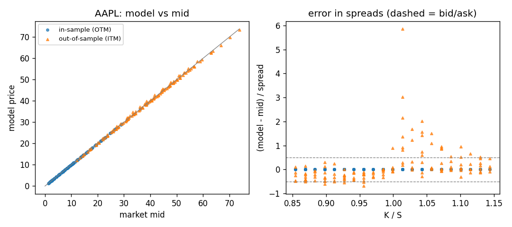
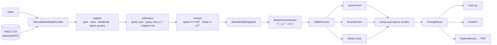
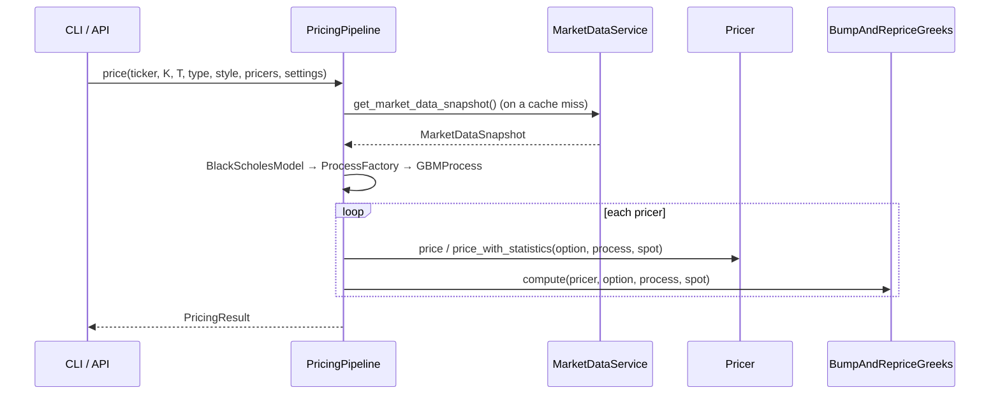

# Option Pricing Engine

   

Prices European and American equity options with Black-Scholes from a ticker. It builds its inputs from live Yahoo Finance option chains and local FRED Treasury yields, and prices with a closed form, a binomial tree and Monte Carlo. It runs as a CLI, a FastAPI service or a PDF report.

## Headline result

Each liquid AAPL option was repriced off the calibrated surface and compared with its live bid/ask on 2026-10-28, 17:03 local time, during US market hours. Liquid means: 30 days to 1 year to expiry, K/S within 0.85–1.15, and a bid/ask spread of at most 10% of mid. A hit is a model price inside [bid − 0.01, ask + 0.01].

| Quote set | n | Hit rate | MAE ($) | Median \|err\|/mid | 90th pct \|err\|/mid | Mean signed err ($) |
| --- | --: | --: | --: | --: | --: | --: |
| In-sample: OTM, used for calibration | 125 | 100.0% | 6e-10 | ≈0 | ≈0 | ≈0 |
| **Out-of-sample: ITM, never used for calibration** | **131** | **79.4%** | **0.31** | **0.61%** | **1.91%** | **+0.05** |
| ITM calls (European closed form) | 69 | 94.2% | 0.24 | 0.58% | 0.92% | −0.21 |
| ITM puts (American, 500-step tree) | 62 | 62.9% | 0.38 | 0.83% | 2.46% | +0.33 |



**Read this table carefully:**

- **In-sample is not an accuracy measure.** The smile spline goes through every calibration quote, so repricing those quotes only checks the round trip.
- **The out-of-sample rows are the real test.** Most misses are ITM puts with K/S between 1.00 and 1.07, which the model prices above mid.
- **Numbers move with the snapshot.** Three AAPL runs within minutes gave out-of-sample hit rates of 79.4%, 74.0% and 70.2%. MSFT at the same time: 71.3% and 67.5% (n = 209). [Full numbers](docs/benchmarks.md).

Reproduce (needs open-market quotes):

```bash
python -m scripts.live_benchmark AAPL docs/img/model_vs_market_aapl.png
```

## Quickstart

```bash
pip install -r requirements.txt
pytest
python main.py price AAPL --strike 350 --maturity 0.5 --type call
```

```text
AAPL  spot=345.2603 [put-call parity, quoted 345.4900]  (Yahoo Finance, 2026-10-28 17:05:02.915035)
european call  K=350.0  T=0.5000y
r=3.7600%  q=-0.2174%  sigma=26.2703%

pricer                       price       delta       gamma       theta        vega         rho
closed_black_scholes       26.5891      0.5507      0.0062    -31.9759     96.7245     81.8152
binomial_tree              26.5895      0.5512      0.0063    -31.9361     96.5743     81.8108
monte_carlo                26.7806      0.5489      0.0061    -31.6447     95.5322     81.5951

monte_carlo: standard error 0.1350, 95% CI [26.5160, 27.0451], 100,000 observations (none)
```

| Command | What it does |
| --- | --- |
| `pytest` | Offline suite: 184 passed in 46 s (Python 3.12.10, Windows 11) |
| `price` | Builds the snapshot and prices with all three pricers; 10 s wall time, most of it spent fetching the snapshot |

To use the API:

```bash
python main.py serve --port 8000
curl -X POST http://127.0.0.1:8000/price -H "Content-Type: application/json" \
  -d '{"ticker":"AAPL","strike":350,"expiry":"2027-03-19","option_type":"put","pricers":["closed_black_scholes","monte_carlo"],"mc_variance_reduction":"control_variate"}'
```

Response (trimmed): closed form `21.9823`; Monte Carlo `21.9803`, SE `0.0530`, 95% CI `[21.8765, 22.0841]`. Interactive docs are at `/docs`.

## Architecture



| Module | Responsibility | Inputs | Outputs |
| --- | --- | --- | --- |
| `market_data/providers` | Fetch raw data; the FRED files are local | ticker | DataFrames: prices, dividends, chains, rates |
| `market_data/loaders` | Clean raw data | DataFrames, valuation date | spot, `Rate` list, dividend yield, `OptionQuote` list |
| `market_data/calibrators` | Parity spot and carry, Newton-Raphson implied vols, smiles | quotes, curves | spot, q(T), `IVQuote` list, smile splines |
| `market_data/services` | Run the steps in order and build the snapshot | provider, ticker, time | `MarketDataSnapshot` |
| `models`, `process` | Reduce the snapshot to one option's r, q, σ | snapshot, K, T | `GBMProcess` |
| `schemes` | One time step: exact GBM, Euler, CRR | process, state | next state or (p, u, d) |
| `pricers` | Price; Monte Carlo statistics | option, process, spot | price, `MonteCarloPriceStatistics` |
| `greeks` | Central finite differences for any pricer | pricer, option, process | `Greeks` |
| `pipeline` | Snapshot cache (15 min TTL), pricer selection, validation | ticker, K, T, settings | `PricingResult` |
| `api` | HTTP schemas, mappers, domain error → status code | JSON | JSON or PDF |
| `reporting` | Market comparison, MC accuracy study, test run, PDF | `OptionReportRequest` | `ReportData` → PDF bytes |

## Module communication



| Contract | Fields | Defined in |
| --- | --- | --- |
| `MarketDataSnapshot` (frozen) | ticker, spot, `rate: YieldCurve` (`r(t)`), `dividend_yield: DividendCurve` (`q(t)`), `sigma: VolatilityModel` (`get_vol(K, T)`), timestamp, source, quoted_spot, spot_source, dividend_source | [market_data_snapshot.py](src/market_data/market_data_snapshot.py) |
| `StochasticProcess` | `r`, `q`, `sigma`, `drift(S,t)`, `diffusion(S,t,K)`, `discount_factor(t)` | [gbm_process.py](src/process/gbm_process.py) |
| `BasePricer.price` | `(option, process, spot) → float` | [base_pricer.py](src/pricers/base_pricer.py) |
| `MonteCarloPriceStatistics` | price, variance, standard_deviation, standard_error, confidence_interval, observations | [monte_carlo_price_statistics.py](src/pricers/monte_carlo_price_statistics.py) |
| `PricingResult` / `PricerResult` | inputs used, plus per-pricer price, `Greeks` and statistics (Monte Carlo only) | [pricing_pipeline.py](src/pipeline/pricing_pipeline.py) |
| Domain exceptions | `TickerNotFoundError`, `MarketDataUnavailableError`, `InvalidOptionRequestError` | [exceptions.py](src/core/exceptions.py) |

## Models and numerics

Derivations and the full benchmark tables are in [docs/models_and_numerics.md](docs/models_and_numerics.md).

| Topic | What the code does |
| --- | --- |
| Dynamics | $dS = (r-q)S\,dt + \sigma S\,dW$, with constant $r=r(T)$, $q=q(T)$, $\sigma=\sigma(K,T)$ per option |
| Closed form | $C = Se^{-qT}N(d_1) - Ke^{-rT}N(d_2)$ |
| Tree | CRR with $u=e^{\sigma\sqrt{\Delta t}}$ and $p=(e^{(r-q)\Delta t}-d)/(u-d)$; American: max(intrinsic, continuation) at each node. Error about −1.94/N for even N; 1000 steps: −1.9e-3 in 0.034 s |
| Monte Carlo | Exact log-Euler step $S e^{(r-q-\sigma^2/2)\Delta t + \sigma\Delta W}$ (no bias under flat parameters) or Euler (1 step: −0.127, about 4.7 SE) |
| Statistics | SE $= s/\sqrt n$, Student-t confidence interval, one-sample t-test against a reference |
| Variance reduction | Antithetic $(Y(Z)+Y(-Z))/2$; control variate on $e^{-rT}S_T$ with $E = S_0e^{-qT}$ and β estimated on the same paths. At 100k paths, SE = 0.044 / 0.023 / 0.018 for none / antithetic / control variate |
| Greeks | Central bump-and-reprice for every pricer, with common random numbers for Monte Carlo; sticky strike |
| Implied vol | Newton-Raphson, European formula, OTM quotes in 70–130% of spot, T ≥ 7 days |
| Surface | Natural cubic spline in $\ln(K/F)$ per expiry (exact interpolation), linear in $\sigma^2T$ across expiries, flat extrapolation |
| Spot and carry | $S = (C-P+Ke^{-rT})e^{qT}$ on near-the-money 7–45-day pairs; $q(T) = r(T) - \ln(F(T)/S)/T$ from parity forwards |
| GARCH | **Not implemented**; no historical or realised volatility model exists |

## Validation

| Method | What is checked | Where |
| --- | --- | --- |
| Analytical benchmark | Tree price within 0.005 of BS 10.4506 / 5.5735 (S = K = 100, T = 1, r = 5%, σ = 20%); tree vs closed form within 1e-3 | `test_binomial_tree`, `test_model_agreement` |
| Hypothesis tests | Monte Carlo within 4 SE of the closed form for each technique × call/put; t-test does not reject the true price at α = 0.01 and rejects price + 1 | `test_monte_carlo`, `test_model_agreement` |
| Convergence | Tree error decreases monotonically over three step counts; MC SE ratio ≈ √(n₂/n₁) within 10% | `test_model_convergence` |
| No-arbitrage bounds | Price bounds, monotonicity in S, K, σ, r; tree put-call parity to 1e-8; American bounds and parity inequality | `test_invariants`, `test_binomial_tree`, `test_american` |
| Stress | Near-zero and very high vol, deep ITM American puts, large dividends | `test_extreme_regimes` |
| Calibration round trip | A synthetic chain priced from a known smile: the surface recovers its vols, parity recovers the spot and forward, a lagging equity feed is corrected | `test_market_data` (52 tests) |
| API and report | Status codes, response fields, validation, PDF renders | `test_api` (27), `test_reporting` (19) |
| Live market | In-sample ≥ 90% and out-of-sample ≥ 70% inside bid/ask; parity spot within 0.1% of the snapshot; ATM within 5% of mid | `pytest -m live` |

**Last live run (2026-10-28):** AAPL passed 4/4, with out-of-sample at 70.2%, just above the 70% threshold. MSFT failed `test_out_of_sample_itm_quotes`. The live suite is not a stable gate.

**Not tested:**

- **Greeks:** only delta, compared with the analytic value in one reporting test. Gamma, vega, theta and rho have no test, and the Greek tests in `test_model_agreement` / `test_model_convergence` are commented out.
- **Closed-form pricer:** `test_black_scholes.py` is fully commented out. The closed form is checked only against the tree.
- **Euler scheme bias:** no test.
- **Surface arbitrage:** no butterfly or calendar arbitrage test.
- **American pricing against a reference value:** only bounds are tested.
- **Data and API wiring:** no test for the Yahoo provider (outside the live suite), the FRED file parsing or the CLI.

## Reporting, CLI and API reference

| CLI | Purpose |
| --- | --- |
| `price TICKER --strike K (--maturity T \| --expiry YYYY-MM-DD)` | Prices, Greeks, Monte Carlo statistics |
| `market-data TICKER` | Spot, rates, carry curve, vol grid at 80–120% moneyness |
| `report TICKER --strike K --maturity T [--out f.pdf] [--skip-tests]` | PDF report; runs the offline test suite unless `--skip-tests` is given |
| `serve [--host] [--port] [--reload]` | Starts the API |

Shared options and their defaults:

- `--type call`, `--style european`
- `--tree-steps 1000`
- `--mc-paths 100000`, `--mc-steps 64`, `--mc-scheme exact`
- `--mc-variance-reduction none`, `--mc-confidence-level 0.95`
- `--seed 42`

| API | Returns | Errors |
| --- | --- | --- |
| `GET /health` | `{"status":"ok"}` |  |
| `POST /price` | `PriceResponse` | 404 unknown ticker · 422 invalid request (both or neither of maturity/expiry, past expiry, non-tree pricer for American) · 503 unusable market data · 500 with no details |
| `GET /market-data/{ticker}?refresh=false` | spot, rates by tenor, q(1y), vol grid | same |
| `POST /report` | PDF; `run_tests` defaults to false | same |

Measured: `/price` took 7.7 s with a cold cache; `/report` took 6.0 s and returned 210 KB of PDF.

The PDF contains:

- stale-data warnings;
- market inputs;
- smiles with their calibration quotes, and a surface heatmap;
- prices against the closed form;
- Greeks against the analytic values;
- a Monte Carlo accuracy table (3 techniques × 10k/50k/100k paths);
- the model-vs-market comparison shown above;
- test results and limitations.

## Limitations

**Model**

- One flat σ, r and q per option inside the process. The tree and Monte Carlo do not use the term structure along the path. No local or stochastic vol and no jumps.
- Greeks are sticky strike. A spot bump does not move σ along the smile, and q is never bumped.
- Implied vols are inverted with the European formula, but listed equity options are American. ITM puts are priced on the tree in the comparison, yet the surface they read from is European-implied.

**Numerics**

- The tree error oscillates with step parity. The tree is a dense O(N²) array, so 5000 steps (the API maximum) means a 25M-cell array per pricing and per Greek bump.
- Tree gamma uses a 2% spot bump, which moves the lattice, and is not smoothed.
- The control-variate β comes from the same paths as the price, which adds an O(1/n) bias.
- The Euler scheme is biased at low `n_steps`.

**Data quality**

- The FRED files are refreshed by hand and currently end on **2026-05-04**, 177 days before the run above. The yields are used as continuous zero rates without conversion.
- The parity carry absorbs rate errors: AAPL's q(T) comes out between −0.19% and −0.37% although AAPL pays dividends.
- Yahoo quotes are delayed and not synchronised across strikes. Outside market hours bid/ask are often zero: the engine then falls back to the quoted spot and trailing dividend yield, and the live tests skip.
- Maturities count calendar days from the valuation time (`days / 365`), with no intraday or trading-day adjustment.

**Arbitrage**

- The cubic spline interpolates every quote exactly, so quote noise goes straight into the surface.
- No butterfly (convexity) or calendar (total variance increasing in T) checks, and no smoothing or SVI fit.

**Performance**

- A snapshot fetches every expiry sequentially: 7–8 s for AAPL or MSFT.
- Each Greek set costs 7 extra pricings.
- The pipeline is built when `create_app()` runs, and the snapshot cache is a per-process dict with no locking.

## Repo layout

```text
main.py                CLI (price, market-data, report, serve)
src/api/               FastAPI app, routers, schemas, mappers, error handlers
src/pipeline/          PricingPipeline, settings, results
src/market_data/       providers, loaders, calibrators, curves, surface, snapshot service
src/models/ process/ schemes/ pricers/ greeks/ instruments/ numerics/
src/reporting/         market comparison, MC accuracy study, pytest runner, PDF sections and charts
tests/                 offline suites, fake provider (known smile), live suite (-m live)
scripts/               benchmarks behind the numbers in this README
docs/                  models_and_numerics.md, benchmarks.md, img/
data/raw/DGS/          FRED Treasury yield CSV files
```

## License

MIT, see [LICENSE](LICENSE).
